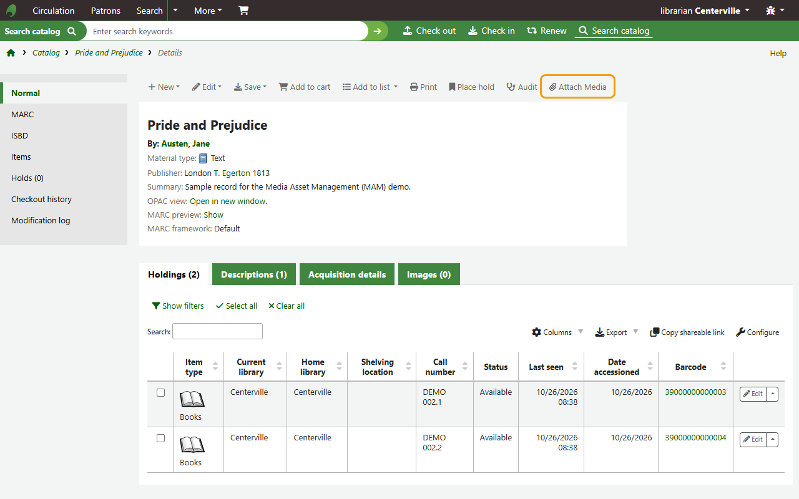
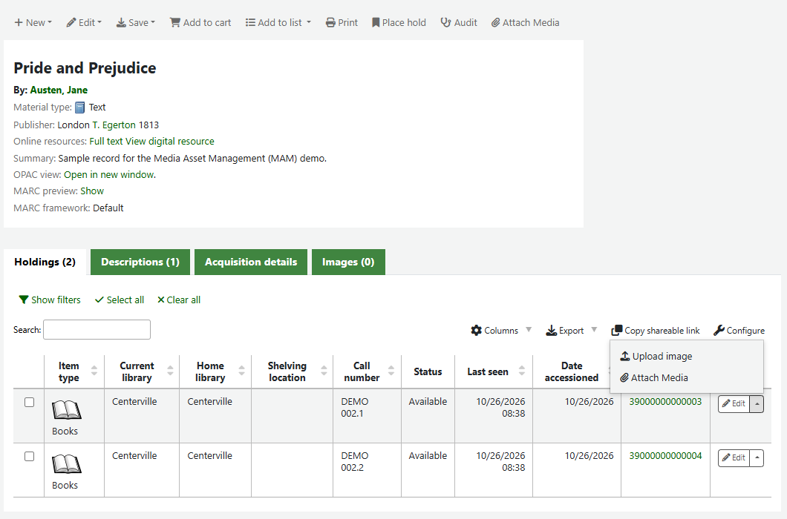
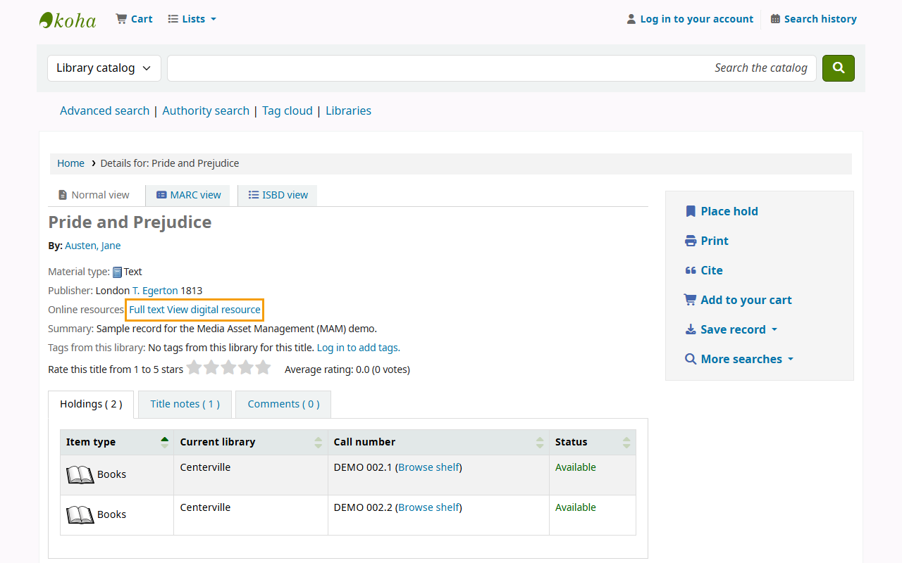
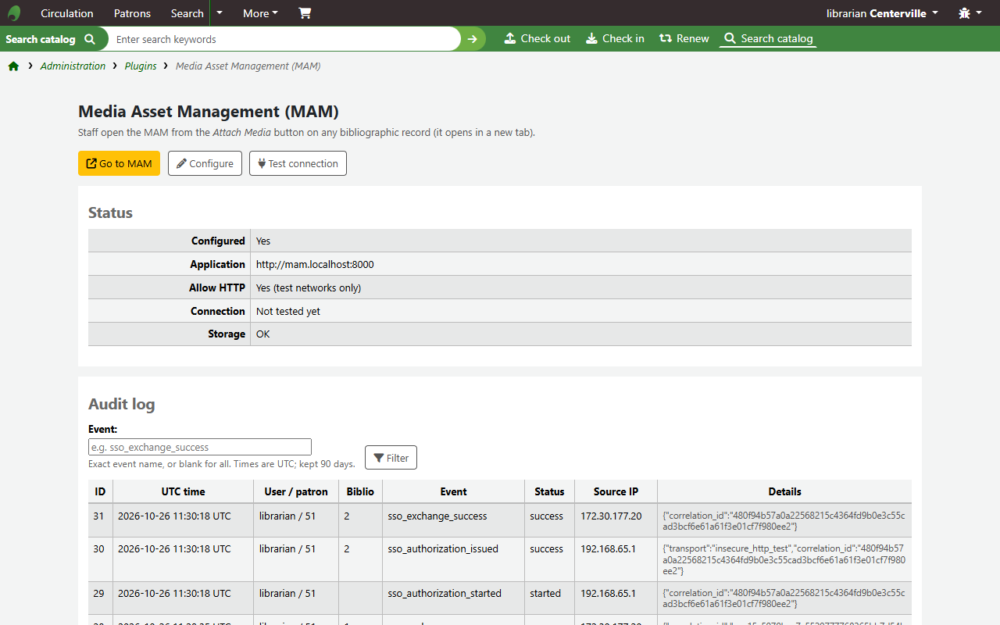

# Media Asset Management (MAM) for Koha

**Bring scans, documents, images, audio and video into your Koha catalogue — with one click and no second password.**

[](https://github.com/tahir242/koha-media-manager/actions/workflows/release.yml)
[](https://github.com/tahir242/koha-media-manager/releases)


**Version 1.1.0 (beta)** · Koha 26.05 (minimum 22.11) · Author: Tahir Ali Channa

---

<p align="center">
  
</p>

> **Try it in one command.** The [koha-mam demo](https://github.com/tahir242/koha-mam/tree/main/demo) runs Koha 26.05,
> the MAM and this plugin, preconfigured: `docker compose up -d --build`.

Media Asset Management (MAM) for Koha connects the Koha staff interface to a dedicated media
application. Cataloguers attach digital media to a **record** or to a **specific item** right where they
work. Staff sign in automatically with their Koha identity, the media is checked and prepared for safe
viewing, and once approved it appears in the staff interface and the OPAC.

> **Two parts, one product.** This repository is the **Koha plugin**. It works together with the
> **[MAM application (koha-mam)](https://github.com/tahir242/koha-mam)**, where media is uploaded, processed,
> reviewed, published and viewed. Install both.

## Why libraries choose it

- **One click from the catalogue** — an **Attach Media** button on every record and an **Attach Media**
  entry for every item (in its **Actions** menu, or next to its **Edit** button).
- **No extra passwords** — secure single sign-on with the staff member's Koha identity.
- **Record and item level** — attach media to a title, or to one copy, even before it has a barcode.
- **Visible where readers look** — record media as an online resource (MARC 856), item media in the
  item's **URL** column (952$u), in the staff interface and the OPAC.
- **Koha stays in control** — Koha permissions decide who may attach media, checked again at every step.
- **Security first** — single-use, short-lived codes; hashed secrets; CSRF protection; rate limits; full audit trail.
- **Non-invasive** — the plugin stores no media and never edits records; publishing uses Koha's official REST API.

## How it works

```
 Koha record or item               MAM application                         Koha catalogue
 Attach Media ── one click ──►  Upload ─► Check & prepare ─► Approve ─►  856 (record) / 952$u (item)
              (signed in automatically)                                  staff interface and OPAC
```

1. A cataloguer chooses **Attach Media** on a record or an item.
2. The MAM opens in a new tab, already signed in, on that record or item.
3. Files are uploaded, validated and prepared for viewing.
4. After approval, the link is added to Koha, and staff and patrons open the media in a secure viewer.

## Screenshots

| **Attach Media** on every record | …and on every item |
|---|---|
|  |  |
| **Published to the OPAC** as an online resource (MARC 856) | **Plugin dashboard**: status, connection test, Go to MAM, audit log |
|  |  |

More screenshots of the MAM itself are in the [koha-mam README](https://github.com/tahir242/koha-mam#screenshots).

## Quick start

1. **Download** `koha-media-manager-v1.1.0-beta.kpz` from
   [Releases](https://github.com/tahir242/koha-media-manager/releases).
2. **Install** it in Koha: *Administration → Plugins → Upload plugin*, then restart Plack and clear the
   template cache.
3. **Configure** it: *Plugins → Media Asset Management (MAM) → Configure* — enter the MAM address,
   an Instance ID, a Client ID and a secret (`openssl rand -hex 32`).
4. **Install the MAM** from [koha-mam releases](https://github.com/tahir242/koha-mam/releases), give it the same
   values and press **Test connection** on the plugin dashboard.

Full instructions: **[User Manual](docs/USER_MANUAL.md)**.

## Requirements

- Koha 26.05 (minimum 22.11) with plugins enabled
- HTTPS on the staff interface (a test-only *Allow HTTP* switch exists for isolated test networks)
- The [MAM application](https://github.com/tahir242/koha-mam), reachable by staff browsers and able to reach Koha's REST API

## Documentation

| Document | For |
|---|---|
| [User Manual](docs/USER_MANUAL.md) | Librarians and Koha administrators: installation, configuration, daily use, troubleshooting, FAQ |
| [Developer Guide](docs/DEVELOPER_GUIDE.md) | Developers and integrators: architecture, sign-in protocol, security model, Koha API, building, testing, releases |
| [Changelog](CHANGELOG.md) | What changed in each release |
| [MAM application](https://github.com/tahir242/koha-mam) | The media side: User Guide, Developer Guide, view statistics, publishing |

## Build from source

```bash
./scripts/build_kpz.sh        # Linux / macOS
scripts\build_kpz.bat         # Windows (double-click or cmd)
```

Each builder packages only the plugin's runtime files and prints the package's SHA-256. Tests:
`prove t/*.t`. Every push is tested by GitHub Actions, and every version tag publishes a release with
the `.kpz` and its change log — see the [Developer Guide](docs/DEVELOPER_GUIDE.md#11-continuous-integration-and-releases).

## Status

**Beta.** Runtime-tested on Koha 26.05 together with the MAM application (record and item sign-in,
publishing to 856 and 952$u, administration and audit). Please test your exact Koha version on a
staging server before production use, and report issues on
[GitHub](https://github.com/tahir242/koha-media-manager/issues).

## License

This plugin is provided as-is for library use and may be modified for institutional requirements.

© 2026 Tahir Ali Channa
