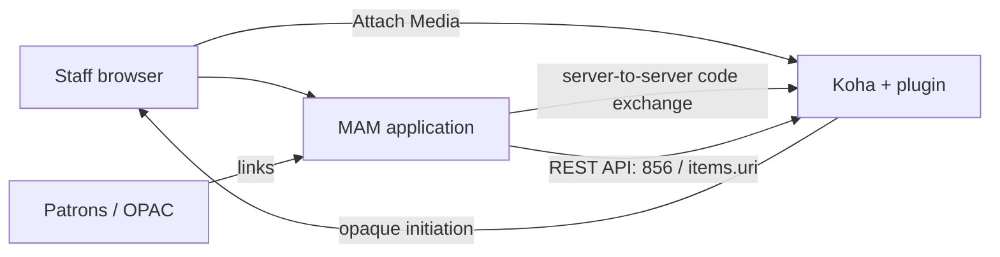

# Media Asset Management (MAM) for Koha — Developer Guide

**Version 1.0.0 (beta)** · Plugin class `Koha::Plugin::Com::Library::MediaManager` · Author: Tahir Ali Channa

This guide is for **developers, integrators and system administrators**: architecture, the sign-in
protocol, the security model, Koha API integration, compatibility, building, testing and releasing.
Library staff should start with the [User Manual](USER_MANUAL.md). The consuming application lives in
the companion repository [koha-mam](https://github.com/tahir242/koha-mam); its
[Developer Guide](https://github.com/tahir242/koha-mam/blob/main/docs/DEVELOPER_GUIDE.md) covers processing,
publishing, the viewer and view counting.

---

## Contents

1. [Architecture](#1-architecture)
2. [Repository layout](#2-repository-layout)
3. [Koha hooks and entry points](#3-koha-hooks-and-entry-points)
4. [Data model](#4-data-model)
5. [Sign-in protocol (code-v2)](#5-sign-in-protocol-code-v2)
6. [Security model](#6-security-model)
7. [Publishing to Koha (MAM side)](#7-publishing-to-koha-mam-side)
8. [Compatibility](#8-compatibility)
9. [Building the plugin package](#9-building-the-plugin-package)
10. [Testing](#10-testing)
11. [Continuous integration and releases](#11-continuous-integration-and-releases)
12. [Deployment reference](#12-deployment-reference)
13. [Contributing](#13-contributing)

---

## 1. Architecture

Responsibilities are split cleanly:

| Koha + this plugin | MAM application (separate, Laravel) |
|---|---|
| Staff identity, sessions and permissions | Its own sessions, users and roles (capped by Koha capabilities) |
| Record and item existence checks | Upload, validation, malware scanning, media processing, storage, viewers |
| One-click entry points (toolbar, item Actions menus) | Review and approval workflow |
| Issuing and redeeming single-use sign-in codes | Publishing links to Koha through the REST API |
| Administration, connection test, audit log | 856 on records, `items.uri` (952$u) on items |

The plugin is a **secure bridge**: it never stores media, never writes catalogue data and never
touches patron or bibliographic tables. All Koha writes are made by the MAM through supported REST
endpoints.



### Components

| Module | Responsibility |
|---|---|
| `MediaManager.pm` | Lifecycle (install, upgrade, uninstall), hooks, Configure page, dashboard, permission policy, initiation, completion, exchange orchestration, audit, maintenance |
| `MediaManager/Security.pm` | Strict validation, CSPRNG values, secret hashing and constant-time comparison, HTML escaping, the test-only HTTP switch |
| `MediaManager/Store.pm` | Parameterised persistence; transactional single-use code consumption |
| `MediaManager/Controller.pm` + `openapi.json` | Native plugin REST route `POST /api/v1/contrib/media-manager/exchange` |
| `MediaManager/Health.pm` | Connection test: approved IPv4 only, pinned connection, TLS verification, no redirects |
| `MediaManager/*.tt` | Configure, dashboard, continuation and error pages; shared layout and breadcrumbs |
| `scripts/maintenance.pl` | Daily purge of expired codes/initiations/rate windows and audit retention |

## 2. Repository layout

```
Koha/Plugin/Com/Library/MediaManager.pm      plugin class
Koha/Plugin/Com/Library/MediaManager/        modules, templates, openapi.json
scripts/build_kpz.{bat,ps1,sh,py}            package builders (each self-contained)
scripts/maintenance.pl                       daily maintenance job
t/*.t                                        isolated test suite (mocked Koha)
t/lib/MockKoha.pm                            Koha/CGI/DB fixtures for the tests
t/integration/concurrency.t                  real-database concurrency test (opt-in)
docs/USER_MANUAL.md                          staff and administrator documentation
docs/DEVELOPER_GUIDE.md                      this guide
.github/workflows/release.yml                CI: test, build, release
CHANGELOG.md                                 release notes (used by the release workflow)
```

Only the files under `Koha/` are packaged. Tests, docs, scripts and any local configuration are
excluded by an explicit allowlist in every builder.

## 3. Koha hooks and entry points

| Hook / entry | Where | What it does |
|---|---|---|
| `intranet_catalog_biblio_enhancements_toolbar_button` | Record details toolbar | Renders the **Attach Media** form (POST + CSRF) when the plugin is ready, the transport is acceptable and the staff member has capabilities. Also re-registers newer hooks in `plugin_methods` (see below). |
| `intranet_js` | `catalogue/detail.pl`, `cataloguing/additem.pl` only | Adds an **Attach Media** entry to each item's **Actions** dropdown. A `MutationObserver` covers holdings rows that DataTables draws or redraws later. Configuration is JSON-encoded and escaped for `<script>`. |
| `tool` | `plugins/run.pl?method=tool` | Dispatches `cud-authorize`, `continue`, `cud-complete`, `cud-test` and the dashboard. |
| `configure` | `plugins/run.pl?method=configure` | Superlibrarian-only settings page. |
| `api_namespace`, `api_routes` | `/api/v1/contrib/media-manager/…` | Registers the exchange route from `openapi.json`. |
| `install`, `upgrade`, `uninstall` | Plugin lifecycle | Idempotent schema migration; uninstall keeps the audit log. |
| `maintenance` | `scripts/maintenance.pl --run` | Bounded batched cleanup. |

**Page detection.** Koha 26.05 calls `intranet_js({page => $script_name})`; 22.11/23.11 pass no
argument, so the plugin also inspects `SCRIPT_NAME`/`REQUEST_URI`. In the browser the script also
requires `body#catalog_detail` or `body#cat_additem`.

**Hook registration.** Koha only calls hooks listed in `plugin_methods`, which it fills from the code
loaded in the worker that handled the upload. A worker still running an older version would record the
old method list. The toolbar hook (registered by every version) therefore re-registers any missing
hooks once per worker.

**Item entries** are keyed by each row's `op=edititem…itemnumber=N` link and are only added where
Koha renders an Actions menu (i.e. for staff who can edit items).

## 4. Data model

Tables use Koha's `get_qualified_table_name` convention (InnoDB). Settings live in `plugin_data`.

| Table suffix | Purpose | Key columns |
|---|---|---|
| `log` | Audit trail (kept on uninstall) | `userid`, `borrowernumber`, `biblionumber`, `itemnumber`, `action`, `status`, `ip_address`, `details` (JSON with correlation ID), `created_at` |
| `requests` | Initiations | `request_hash` (SHA-256), `session_hash`, `patron_id`, `biblio_id`, `item_id`, `branch`, `binding`, `expires_at`, `consumed_at` |
| `codes` | One-time authorization codes | `code_hash` (SHA-256), `patron_id`, `biblio_id`, `item_id`, `branch`, `issuer`, `audience`, `client_id`, `issued_at`, `expires_at`, `consumed_at`, `browser_state` |
| `rates` | Fixed-window rate counters shared by all workers | `bucket`, `window_id`, `attempts` |

`install` and `upgrade` run the same idempotent migration (`CREATE TABLE IF NOT EXISTS` plus
`ADD COLUMN` checked against `information_schema`) and add missing defaults without overwriting
administrator settings. No migration ever drops or deletes data.

## 5. Sign-in protocol (code-v2)

A confidential-client authorization-code exchange. It is not an OAuth2/OIDC provider, and it is
separate from Koha's own OAuth2 API authentication.

### URLs

| Step | URL |
|---|---|
| MAM start | `GET {mam}/sso/koha/start?request={initiation}` |
| Koha return | `GET {koha}/cgi-bin/koha/plugins/run.pl?class=Koha%3A%3APlugin%3A%3ACom%3A%3ALibrary%3A%3AMediaManager&method=tool&op=continue&request={initiation}&state={state}` |
| MAM callback | `GET {mam}/sso/koha?code={code}&state={state}` |
| Exchange | `POST {koha}/api/v1/contrib/media-manager/exchange` |
| Health (optional) | `GET {mam}/.well-known/koha-media-manager` → `{"protocol":"code-v2","audience":"media-manager"}` |

The consumer must use fixed, configured Koha return and exchange URLs; never caller-supplied ones.

### Sequence

```mermaid
sequenceDiagram
    participant B as Staff browser
    participant K as Koha plugin
    participant M as MAM
    B->>K: POST cud-authorize (+ CSRF, biblionumber, optional itemnumber)
    K->>K: Validate staff, record and item; bind initiation to session
    K-->>B: 303 MAM start with opaque request
    B->>M: Start
    M->>M: Create random state bound to browser session
    M-->>B: 303 fixed Koha return URL with request and state
    B->>K: GET continue (staff cookie)
    K-->>B: Local auto-submit form + CSRF
    B->>K: POST cud-complete
    K->>K: Consume initiation; same session?; re-check; issue code bound to state
    K-->>B: 303 fixed MAM callback with code and state
    B->>M: Callback (same MAM session)
    M->>M: Verify browser state
    M->>K: Server POST exchange with client credentials and code
    K->>K: Lock code; validate bindings; re-check staff, record, item; consume + audit
    K-->>M: Identity, context, capabilities, state
    M->>M: Verify issuer, audience, state; rotate session
    M-->>B: 303 record or item workspace
```

### Browser binding

- Initiations carry 256 random bits, expire after 120 seconds and are bound to a hash of the originating
  Koha session; they contain no identity and cannot be exchanged.
- The MAM generates at least 256 bits of state (43–128 base64url characters), bound server-side to the
  browser session and pending initiation, single-use, expiring within 120 seconds.
- The consumer rejects unsolicited or mismatched state **before** exchanging, then compares the state
  returned by the exchange with the pending one. This blocks forwarded links, login CSRF and code
  substitution.

### Exchange request

```http
POST /api/v1/contrib/media-manager/exchange HTTP/1.1
Host: staff.koha.example.org
Content-Type: application/json
Accept: application/json
X-Media-Client: koha-mam
X-Media-Secret: <64-character random secret>

{"code":"<64 lowercase hexadecimal characters>"}
```

- Only `code` is accepted in the body (max 1024 bytes); identity or context overrides are rejected.
- Do not send cookies or an `Authorization` header: Koha processes OAuth/Basic headers before the plugin
  controller. The route intentionally has no `x-koha-authorization` and performs its own client
  authentication.

### Exchange response (HTTP 200)

```json
{
  "success": true,
  "protocol": "code-v2",
  "iss": "mylibrary",
  "aud": "media-manager",
  "identity": { "provider": "koha", "instance": "mylibrary", "patron_id": 1001, "userid": "cataloguer01" },
  "context": { "biblio_id": 12345, "branch": "MAIN", "item_id": 67890 },
  "capabilities": ["media.access", "media.upload"],
  "issued_at": 1792584000,
  "expires_at": 1792584060,
  "correlation_id": "<64 hex characters>",
  "state": "<browser-bound state>"
}
```

- All properties are required except `context.item_id`, which is `null` for a record-level sign-in.
  IDs and timestamps are JSON integers; `identity.instance` equals `iss`; `aud` is `media-manager`.
- `item_id`, when present, is an item of `biblio_id` — verified at initiation, completion and exchange.
- No name, email, password, cookie, access token or invented login time is returned.
- Link accounts by `(instance, patron_id)`. Capabilities are an upper bound.

| Capability | Granted to |
|---|---|
| `media.access`, `media.upload` | Cataloguers (`catalogue` + `plugins.tool` + `editcatalogue.edit_catalogue`) |
| `media.manage`, `media.admin` | Superlibrarians (in addition to the above) |

### Errors

| HTTP | `error` | Meaning |
|---|---|---|
| 400 | `https_required` | Request not over HTTPS (and *Allow HTTP* is off) |
| 400 | `invalid_request` | Malformed body |
| 400 | `invalid_grant` | Expired, replayed, unknown or wrongly bound code (indistinguishable on purpose) |
| 401 | `invalid_client` | Wrong client ID or secret |
| 403 | `access_denied` | Staff, record or item authorization no longer valid |
| 413 | `invalid_request` | Body too large |
| 429 | `rate_limited` | Rate limit (`Retry-After: 60`) |
| 503 | `temporarily_unavailable` | Plugin disabled or not configured |

Koha middleware can reject requests before the controller with its own envelope; consumers must rely on
the HTTP status.

### Codes, rotation and rate limits

- Codes: 256 CSPRNG bits, stored as SHA-256 hashes, TTL 60 s (30–120). A primary-key row lock
  serialises consumption; identity is returned only after consumption and audit commit together.
  A lost response does not restore a consumed code — start a new sign-in.
- Secret rotation: the current and the immediately previous secret digest are accepted during the
  overlap (default 300 s, 120–3600).
- Rate limits (shared database counters): 20 initiations per staff member per minute; 60 exchanges per
  peer IP and 600 in total per minute. Forwarded IP headers are not trusted.
- Incompatible changes will use a new protocol identifier.

## 6. Security model

### Design controls

| Risk | Control |
|---|---|
| Replayable or forgeable sign-in links | Opaque single-use codes with server-side context; nothing meaningful in the URL |
| Forwarded callbacks, login CSRF | Initiation bound to the Koha session; code bound to the consumer's browser state |
| Concurrent replay | InnoDB primary-key row lock; consume + audit in one transaction |
| Over-broad permissions | Fixed named policy mapped to real Koha subpermissions; re-checked at exchange |
| Stale accounts | Locked, expired, lost, gone-no-address and debarred accounts refused at every step |
| Invalid record or item context | Positive bounded integers; `Koha::Biblios`/`Koha::Items` existence and ownership checks |
| Secret disclosure | Hash-only storage, blank replacement field, constant-time comparison, bounded rotation |
| CSRF on administration | `Koha::Token` CSRF plus POST for every state change (`cud-` operations) |
| Script injection | Server-side HTML escaping; script configuration JSON-encoded with `<`, `>`, `&` escaped |
| Server-side request forgery in diagnostics | Explicit IPv4 approval, DNS validation, pinned connection, TLS verification, no redirects |
| Audit tampering or loss | Sensitive operations fail closed; no identity is returned unless the audit write commits |

### Production checklist

- **HTTPS everywhere** — staff interface, MAM, return and exchange URLs. *Allow HTTP* is for isolated
  test networks only; disable it and replace the secret before go-live.
- **Reverse proxies:** configure trusted TLS termination so CGI sees `HTTPS=on` and Mojolicious sees an
  HTTPS request URL. Do not trust arbitrary forwarded headers.
- **Logs:** redact query strings on start/return/callback paths; never log request bodies or the
  `X-Media-Secret` header. The plugin itself never logs codes or secrets.
- **Headers:** `Cache-Control: no-store` and `Referrer-Policy: no-referrer` on all hand-off paths
  (the plugin sets them on its redirects and pages; add them at the proxy for middleware errors).
- **Limits:** cap exchange bodies at 1024 bytes and add request rate limits at the proxy.
- **Cookies:** Secure, HttpOnly, SameSite=Lax for both applications.
- **Data:** audit entries contain personal operational data; restrict database and backup access and
  set retention to your policy. Encryption at rest is an infrastructure responsibility.
- **Sessions:** the grant is a snapshot; the MAM must apply its own session lifetime. Remote logout is
  not provided.

## 7. Publishing to Koha (MAM side)

Publishing is done by the MAM, not the plugin. The MAM uses its own least-privilege Koha API account
(OAuth2 `client_credentials` at `POST /api/v1/oauth/token` with `RESTOAuth2ClientCredentials` enabled),
separate from the plugin's exchange credential and from the staff identity.

| Operation | Endpoint | Koha permission |
|---|---|---|
| Read record (JSON / MARCXML) | `GET /api/v1/biblios/{id}` | `catalogue` |
| Write record links (856) | `PUT /api/v1/biblios/{id}` (`application/marcxml+xml`, `x-framework-id`) | `editcatalogue: edit_catalogue` (Koha 23.11+) |
| Read item | `GET /api/v1/items/{id}` | `catalogue` |
| Write item link (`items.uri`, 952$u) | `PUT /api/v1/biblios/{id}/items/{item_id}` with `{"uri": "…"}` | `editcatalogue: edit_items` |

**Record media (856).** The MAM owns exactly one 856 per asset, recognised by its viewer URL in `$u`
(`$3` materials, `$y` link text, `$z` note, `$7` access status). Every write re-reads the record,
detects concurrent edits, preserves every other field and framework, and verifies the result by reading
it back.

**Item media (952$u).** Each item gets one stable link, `{mam}/item/{itemnumber}`, however many files
it has; it opens the file directly or lists several. Koha shows several URIs separated by `" | "`, so a
hand-catalogued URL is kept and the MAM link is appended. The link is removed only when the item's last
published file is unpublished. The item write is verified by reading the item back before any older
record-level link is removed.

Do not emulate missing REST features with direct SQL or private CGI endpoints. Honour `429/Retry-After`
and never blindly retry a full-record write after a timeout.

## 8. Compatibility

Koha **26.05** is the primary target and has been runtime-tested with the MAM (plain HTTP test network):
install and upgrade, configuration, record toolbar, item Actions menus, the full sign-in round trip,
REST exchange, connection test, audit log, and publishing to 856 and 952$u.
Not yet runtime-tested: HTTPS behind a reverse proxy, Koha 22.11–25.11, and multi-worker load.
The `minimum_version` of 22.11 is a design target, not a certification — validate your exact release on staging.

| Interface | Notes |
|---|---|
| Record toolbar hook | Present in 22.11 and 26.05; called without arguments, so the plugin reads `biblionumber` from CGI and validates it. |
| `intranet_js` | No arguments in 22.11/23.11; `{page => …}` in 26.05. |
| Items | `Koha::Items->find`, `$item->biblionumber` (22.11+). |
| `run.pl` | Requires `plugins → tool` for any tool method. |
| `haspermission` | Structured requirement, e.g. `editcatalogue => 'edit_catalogue'`. |
| Plugin REST routes | `api_namespace` / `api_routes` (22.11+), mounted under `/api/v1/contrib/{namespace}`. |
| CSRF | `Koha::Token` with session ID; `cud-` operations over POST. |
| Record PUT | Absent in 22.11.00; present in 23.11+. |
| Item PUT | `PUT /biblios/{id}/items/{item_id}` present in 26.05; verify on older releases. |

Primary sources: [Koha source](https://github.com/Koha-Community/Koha) (22.11 and 26.05.x branches),
[plugin base documentation](https://perldoc.koha-community.org/Koha/Plugins/Base.html),
[REST API documentation](https://api.koha-community.org/).

## 9. Building the plugin package

Every builder writes `MediaManager.kpz` (or the name given as the first argument) to the repository
root, packages only the 12 allowlisted files, refuses unexpected or empty files, stamps entries with the
build time (so Koha's template cache refreshes), verifies the archive and prints its SHA-256.

| Builder | Platform | Needs |
|---|---|---|
| `scripts\build_kpz.bat` | Windows 10 1803+ / 11 (double-click or cmd) | Built-in `tar.exe` and `certutil.exe` only |
| `scripts/build_kpz.ps1` | Windows PowerShell 5+ | — |
| `scripts/build_kpz.sh` | Linux / macOS | `zip` (or `bsdtar`, built into macOS) |
| `scripts/build_kpz.py` | Any | Python 3.8+ |

```bash
./scripts/build_kpz.sh                          # MediaManager.kpz
./scripts/build_kpz.sh koha-media-manager.kpz   # custom name
```

## 10. Testing

### Isolated suite

```bash
prove -v t/*.t
```

294 assertions in 14 files run against `t/lib/MockKoha.pm` — no Koha, database or network needed.
Coverage includes configuration validation and attacks, identifier validation, credential comparison and
rotation, valid/expired/replayed/invalid grants, account and permission revocation, record and item
substitution, CSRF on every form, toolbar and item-menu output, hook registration, schema migration,
secret-free audit data, DNS and TLS pinning, *Allow HTTP*, error pages and audit pagination.
Without `prove`, run each file with `perl t/<file>.t`.

Mocks verify local logic only — not real Koha APIs, SQL, Template Toolkit output or middleware.

### Real-database concurrency test

Needs DBI with DBD::mysql or DBD::MariaDB and a disposable database named exactly `mediamanager_test`:

```bash
MM_TEST_DSN='dbi:mysql:database=mediamanager_test;host=127.0.0.1' \
MM_TEST_USER=… MM_TEST_PASSWORD=… prove -v t/integration/concurrency.t
```

Two forked connections race to consume one code; exactly one succeeds. It skips unless configured.

### Staging checklist

1. Upload and enable; the REST route answers 401 (not 404) after restarting workers.
2. Install and repeated upgrade keep settings and audit rows.
3. Configuration rejects missing or wrong CSRF and never shows stored secrets.
4. Record toolbar shows one button; item Actions menus show one entry; unauthorised staff and
   deleted records or items get nothing.
5. Full browser round trip for a record and for an item, including both state checks.
6. HTTPS, proxy, headers and log redaction.
7. Multiple workers; revoke permissions, lock the patron, delete the record or item mid-flow.
8. Secret rotation during an in-flight sign-in.
9. Connection test with DNS changes, private destinations, TLS errors and redirects.
10. Audit pages, filters, UTC timestamps and retention.
11. Maintenance, then uninstall: logs kept, pending sign-ins invalidated.

## 11. Continuous integration and releases

`.github/workflows/release.yml` runs on every push and pull request:

| Job | When | What |
|---|---|---|
| **test** | Every push / pull request | Installs Perl dependencies and runs `prove t/*.t` |
| **build** | After tests | Builds the KPZ with `scripts/build_kpz.sh` and uploads it as a workflow artifact |
| **release** | Tags `v*` only | Checks the tag matches `$VERSION`, extracts that version's notes from `CHANGELOG.md`, and publishes a GitHub Release with the versioned `.kpz` attached |

**Cutting a release**

1. Set `our $VERSION` in `MediaManager.pm` (numeric, e.g. `1.0.1` — Koha compares versions numerically).
2. Add a `## [1.0.1] - YYYY-MM-DD` section to `CHANGELOG.md`.
3. Commit, then tag and push:

   ```bash
   git tag -a v1.0.1 -m "v1.0.1"
   git push origin main --follow-tags
   ```

A tag with a suffix (`v1.0.0-beta`, `v1.1.0-rc.1`) is published as a **pre-release**; the suffix is not part
of `$VERSION`. The asset is named `koha-media-manager-<tag>.kpz`. If the changelog has no matching
section, the release notes list the commits since the previous tag.

## 12. Deployment reference

- **Dependencies** (already used by Koha): Modern::Perl, CGI, DBI, JSON::PP, Digest::SHA,
  Bytes::Random::Secure, IO::Socket::SSL, Socket, POSIX, URI::Escape. No new frameworks.
- **After uploading a KPZ:** restart Plack (`koha-plack --restart`), clear the template cache
  (`<template_cache_dir>` in `koha-conf.xml`) and restart Apache. Koha keeps old Perl code in memory.
- **Instances:** sign-in storage is per instance; never share plugin tables or reuse an Instance ID
  across production instances.
- **Maintenance:** run `scripts/maintenance.pl --run` daily as the instance user with `KOHA_CONF` and
  `PERL5LIB` set (e.g. via `koha-shell`). Each run handles at most 100 batches of 1000 rows per table;
  codes and initiations are kept one day after expiry, rate windows one hour.
- **Uninstall** drops `codes`, `requests` and `rates`; the audit `log` table is retained for your records
  and can be removed by a DBA after export.

## 13. Contributing

- Keep changes small and covered by tests in `t/`; run `prove t/*.t` before pushing.
- Never package or commit secrets; the builders' allowlist must list every new runtime file.
- Escape all output, validate all input, and keep every state-changing operation behind POST + CSRF.
- Bump `$VERSION` and add a `CHANGELOG.md` entry for every release.
